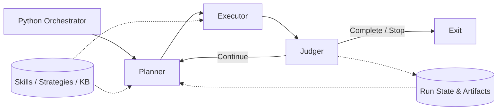

# Groove

**A groovy RSI agent framework.**

Groove is a lightweight, general-purpose **Recursive Self-Improvement (RSI)** agent framework. It is designed around a simple **Planner → Executor → Judger** workflow, swappable LLM backends, and reusable Skills, Strategies, and Knowledge.

> **Project status:** Architecture and source-code scaffold proposals. The runnable implementation has not been built yet.

## Design at a glance

- **Three stateless roles:** Planner chooses the next action, Executor performs it, and Judger verifies the outcome and decides whether the goal is complete.
- **Execution-only orchestrator:** A small deterministic Python loop coordinates the roles without making domain decisions or directly editing business state.
- **Explicit run history:** A persistence API records plans, results, judgments, evidence, and immutable artifacts.
- **Versioned learning assets:** Reusable **Skills**, **Strategies**, and **Knowledge Base (KB)** are separate from the state of an individual run.
- **Gated RSI:** Candidate changes to Skills, Strategies, or KB are evaluated before promotion. Role prompts, the orchestrator, and acceptance criteria are outside automatic RSI scope in V1.
- **Pluggable backends:** The proposed adapter layer supports Claude Agent SDK and OpenAI-compatible local inference hosts such as LM Studio, Ollama, and vLLM.

## Documentation

- [System architecture](docs/architecture.md) — decisions, agent contracts, run state, strategy hierarchy, and RSI boundaries.
- [Implementation proposal](docs/implementation.md) — Python package scaffold, backend adapters, interfaces, persistence, testing, and implementation roadmap.

## Planned implementation

1. **Minimal loop:** Mock Planner / Executor / Judger with typed contracts and durable per-step recording.
2. **Real backends:** Claude Agent SDK integration and OpenAI-compatible local model adapter with a bounded tool loop.
3. **Reliability:** Crash recovery, timeouts, resource budgets, immutable artifacts, and verification gates.
4. **RSI:** Candidate learning deltas, baseline evaluation, promotion, and rollback.

Groove aims to keep the **workflow small and predictable**, while allowing its **learning assets to evolve**.
