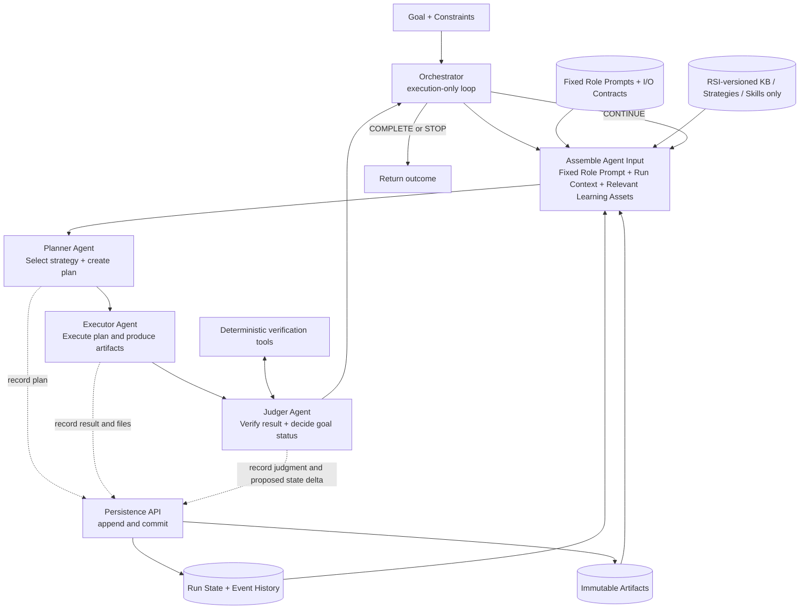
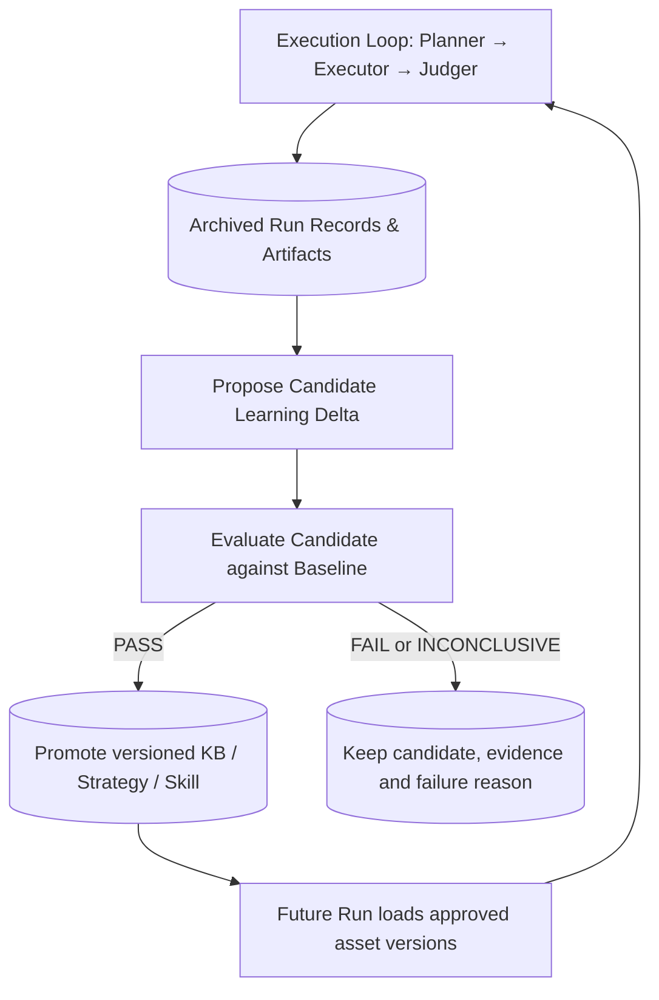

# General-Purpose Agent Workflow + RSI — V1 System Design

**Version:** V1.3 — backend integration update, November 7, 2026  
**Status:** Agreed baseline / design draft  
**Scope:** General-purpose agent workflow (debugging, coding, profiling, research, experimentation) with a minimal path to Recursive Self-Improvement (RSI).  
**Core principles:** **3 Stateless Agents · Fixed Role Prompts · Execution-Only Orchestrator · Persistent Run Records · RSI Changes Only KB/Strategies/Skills**

## 1. 最新设计结论（Decisions）

1. **仅保留三个核心 Agent**：`Planner → Executor → Judger`。
2. **Verification 和 Decision 合并到 Judger**。Judger 检查本轮结果、参考客观测试证据，并判断当前 Goal 是否完成、是否继续。必要的编译、测试、日志解析等仍由确定性 **Verification Tools** 执行；它们是工具，不是独立 Agent。
3. **Orchestrator 是纯执行 Loop**：调用组件、传递结构化结果、依据明确的返回信号循环或退出；不推理业务问题，不自行改写业务 State、Knowledge、Strategy 或 Skill。
4. **不需要独立 Recorder Agent / Recorder 服务**。持久化由普通代码（例如 `store.append_event(...)` / `store.commit(...)`）提供；每个阶段的输出都及时落盘。**Judger 提议 State Delta，不直接写数据库。**
5. **区分两类持久化数据**：
   - **Run State + Artifacts**：本次 Run/Campaign 的计划、结果、判断、进度、日志、代码及证据（即使 Run 结束也可归档）。
   - **RSI Learning Assets**：跨 Run 复用的 **Knowledge、Strategies、Skills**，有独立版本和提升（promotion）流程。
6. **Strategy 是 Planner 的可检索决策资源**（Planning Policy），不属于 Orchestrator 的硬编码调度规则，也不一定是新 Agent。复杂系统可采用逻辑上的三级 Strategy：General → Domain → Tactical；优先用 ID/引用复用，避免严格树形继承。
7. **Learning Delta ≠ Run State Delta**。前者改未来任务的策略/技能/知识，后者只推进当前任务。候选 Learning Delta 需要评估通过后才能进入正式资产版本。
8. **固定 Agent Role Prompt**：Planner / Executor / Judger 的职责、权限和输入输出契约在 V1 保持固定并版本化；RSI 不自动修改这些 Prompt、Orchestrator 代码或 Goal Acceptance Criteria。
9. **输入只分三类，不再定义独立的 “Dynamic Context” 资源**：`Agent Input = Fixed Role Prompt + Run Context + Relevant Learning Assets`。其中 Run Context 来自本次 Run（Goal、State、History、Artifacts），Learning Assets 仅限 KB、Strategies、Skills。
10. **RSI V1 的可变学习范围严格限定为 KB、Strategies、Skills**：Run State 可以持续变化，但只是推进当前任务，不是 RSI Learning Delta。

> **一句话**：**Fixed roles + per-run state + versioned KB/Strategies/Skills; Orchestrator runs the loop, Agents reason and act, RSI improves only the learning assets.**

## 2. Prompt、Run Context、Learning Assets：明确三层边界

不把 **Dynamic Context** 作为独立资源层。它只是过去对「每次调用动态组装的输入」的简称，容易与 KB / Strategies / Skills 重复，**V1 正式设计中取消这一概念名**。

| 层 | 具体内容 | 何时变化 | RSI 是否允许改动 |
|---|---|---|---|
| **Fixed Role Prompt** | Planner / Executor / Judger 的职责、行为约束、权限、I/O Contract | 通过单独工程发布与评估升级；一个 Run 中固定版本 | **否（V1）** |
| **Run Context** | 当前 Goal、不可变验收标准引用、当前 State、History、Evidence / Artifact refs | 随本次 Run 的执行持续变化 | **否**；是 Run State Delta |
| **Learning Assets** | **KB、Strategies、Skills**（含版本、适用范围、文件/工具引用） | 通过独立 Candidate → Evaluation → Promote 流程发布 | **是，且仅限这三类（V1）** |

```text
Agent Call Input
  = Fixed Role Prompt (role + contracts)
  + Run Context (goal + state + history + artifacts)
  + Relevant Learning Assets (KB + Strategies + Skills)
```

**三者不是三个同时加载的完整 Prompt**：普通代码组装本轮输入；Agent 可以按需通过受控工具检索 KB、Strategies、Skills，避免把整个 Registry 或完整历史塞进上下文窗口。组装过程只引用这三层资源，不制造第四种长期记忆。

每个角色的默认访问重点不同：

| Role | 必需的 Run Context | 常用 Learning Assets |
|---|---|---|
| **Planner** | Goal、已完成的步骤、当前 State、Judger Feedback、证据引用 | **Strategies + KB**，以及可用 Skills 的元数据；输出所选 Strategy/Skill 的 ID 与版本 |
| **Executor** | 具体 Plan、执行约束、所需输入文件与证据引用 | **Skills** 的说明/代码，必要时查询 KB；不擅自重写 Goal |
| **Judger** | 原始 Goal/Acceptance Criteria、Plan、Result、真实测试证据 | 主要依赖客观 Verification Tools；必要时只读 KB，不允许修改成功标准 |

**Role Prompt 版本化，而不是用 RSI 自动学习它**。例如三个 Role 的固定职责可简写为：

```text
Planner: Analyze goal and run evidence; select strategy and skills; output ActionPlan.
         Do not execute actions or mutate persistent state.
Executor: Execute ActionPlan with permitted tools/skills; report actual results and artifacts.
          Do not redefine goal or acceptance criteria.
Judger: Verify execution evidence; decide COMPLETE/CONTINUE/STOP; propose Run State Delta.
        Do not change acceptance criteria or commit persistent learning changes.
```

当模型行为出现 Role 边界问题时，可以通过**普通工程发布**更新 Role Prompt 并做回归测试，但这不属于 V1 的自动 RSI Learning Delta。

## 3. 核心执行架构（Current Run）



说明：图中虚线表示普通代码记录结构化结果，不是 Agent 自己拥有任意修改共享状态的权限。实际执行应**在每个阶段结束后立即保存产物**，不能只等 Judger 结束才保存，否则 Judger 失败可能导致 Executor 的文件/结果丢失。

**每轮逻辑：**

`Assemble Input (Fixed Role + Run Context + Relevant KB/Strategies/Skills) → Planner → Persist Plan → Executor → Persist Result / Files → Judger (with verification tools) → Persist Judgment / Run State Delta → Continue or Exit`

## 4. 组件职责和权限边界

| Component | 主要职责 | 不应该负责 |
|---|---|---|
| **Planner Agent** | 使用 Run Context 及所检索 KB / Strategies / Skills 元数据；提出下一步 Plan、选择 Strategy 和 Skill | 执行任务、直接改写全局 State、宣告整个 Goal 成功 |
| **Executor Agent** | 执行 Plan、调用工具、产生 Observation、Result、代码/日志/Trace | 重新定义成功标准、修改历史结论 |
| **Judger Agent** | 结合 Goal/Criteria 与执行证据，调用验证工具；判断 `CONTINUE / COMPLETE / STOP`；提出本轮 State Delta 和 Planner Feedback | 静默更改原始 Goal/Criteria、直接修改正式 Learning Assets、独占保存文件 |
| **Orchestrator** | 普通 Python loop：调用、传参、检查受限输出状态、退出或下一轮 | Domain Reasoning、决定哪个 Hypothesis 正确、直接编辑业务 State |
| **Store API**（普通代码） | 持久化每步输入输出、事件、状态版本、文件引用，提供只读查询 | 业务推理与策略选择 |
| **Strategy/Skill/KB Registry**（可与 Store 同实现） | 根据 ID/版本检索可复用学习资产 | 决定当前问题该采用什么策略 |

**所有 Agent 都使用固定版本 Role Prompt**；每轮仅更换 Run Context 与被检索的 Learning Assets。**Stateless Agent** 的含义：每次 Agent 调用没有必须依赖的隐藏跨调用内存；内部仍可以有本次推理过程、工具调用和临时上下文。

**Pure Orchestrator** 的含义：没有业务判断或语义 State 编辑；但仍有不可避免的控制流与操作性职责（调用 API、处理异常、重试/预算/超时、根据 `action` 退出）。

## 5. 数据契约（Input / Output Contracts）

### 5.1 每轮 Planner 的输入（Run Context + Learning Asset References）

下面是动态输入载荷的示例；调用时另外附加 Planner 的**固定、版本化 Role Prompt**。不是另一种叫作 Dynamic Context 的资产。

```json
{
  "run_id": "nan_042",
  "goal": "Find root cause of intermittent training NaN",
  "acceptance_criteria_ref": "criteria://nan_042@v1",
  "constraints": { "max_iterations": 10 },
  "iteration": 3,
  "run_state": {
    "status": "RUNNING",
    "open_questions": ["Which layer first corrupts the tensor?"],
    "confirmed_findings": [],
    "prior_feedback": "Previous kernel tests were inconclusive"
  },
  "recent_event_refs": ["run://nan_042/events/1-9"],
  "artifact_refs": ["artifact://nan_042/trace_003@sha256:..."],
  "learning_asset_refs": {
    "strategies": ["strategy://debugging/progressive_isolation@v1"],
    "knowledge": ["kb://known_issues/h2d_memory_race@v1"],
    "skills": ["skill://trace_analysis@v2"]
  }
}
```

**完整历史保存在 Store，不等于全部塞进 Prompt**：Run Context 可先提供 relevant summary + immutable references；Planner 可通过受控读取工具按需打开原始记录和文件。Learning Asset refs 指向已经批准的版本，不代表每次都预先加载全部资产文本。

### 5.2 Planner Output

```json
{
  "plan_id": "plan_004",
  "objective": "Test whether corruption precedes kernel execution",
  "selected_strategy": "strategy://debugging/broaden_scope@v1",
  "selection_reason": "Kernel experiments were inconclusive; failures correlate with memory pressure",
  "selected_skills": ["skill://hip_memory_trace@v1"],
  "actions": ["Trace allocation and H2D copy lifetime"],
  "expected_observations": ["Evidence of allocation/copy ordering"],
  "verification_criteria": ["Trace captured", "Timeline is inspectable"]
}
```

### 5.3 Executor Output

```json
{
  "plan_id": "plan_004",
  "execution_status": "SUCCEEDED",
  "observations": ["H2D transfer and memory-release events recorded"],
  "artifact_refs": ["artifact://nan_042/hip_trace_004@sha256:..."],
  "errors": []
}
```

`execution_status=SUCCEEDED` 只表示执行动作成功，不表示假设成立、Root Cause 已确定或 Goal 完成。

### 5.4 Judger Output（Verification + Decision + State Delta）

```json
{
  "verification": {
    "status": "PASS",
    "checks": [
      { "name": "trace_parseable", "status": "PASS" },
      { "name": "evidence_supports_root_cause", "status": "INCONCLUSIVE" }
    ],
    "evidence_refs": ["artifact://nan_042/hip_trace_004@sha256:..."]
  },
  "decision": {
    "action": "CONTINUE",
    "goal_achieved": false,
    "reason": "Trace exists but root cause is not yet established",
    "feedback_for_planner": "Design a controlled memory-lifetime experiment"
  },
  "proposed_run_state_delta": {
    "add_open_questions": ["Can H2D copy outlive pinned-memory ownership?"],
    "add_findings": ["Relevant H2D timeline obtained"]
  }
}
```

**Judger 的两个判断必须分开**：

- **Verification**：本轮 Action 的输出是否可信、是否符合本轮检查条件？可以调用 Python tests / compiler / parsers / reproducibility checks，语义判断应注明证据与不确定性。
- **Goal Decision**：整个 Goal 是否真正达成？实验 `PASS` 并不等于 `COMPLETE`。

**持久化约束**：Judger 返回的 State Delta 是**提案**；Store API 根据允许的字段、版本号和状态转换规则提交。系统不以 Judger 生成的文字覆盖原始证据或改变 Goal 的既定验收标准。

## 6. 最小 Orchestrator 伪代码

```python
def run(goal, services, max_iterations=10):
    run_id = services.store.create_run(
        goal=goal,
        role_prompt_versions=services.role_prompts.versions(),
        learning_asset_snapshot=services.learning_registry.approved_snapshot(),
    )

    for _ in range(max_iterations):
        run_context = services.store.load_planner_context(run_id)
        assets = services.learning_registry.select_for_run(run_id, run_context)
        planner_input = services.inputs.compose(
            role_prompt=services.role_prompts.planner,
            run_context=run_context,
            learning_assets=assets,
        )

        plan = services.planner.run(planner_input)
        services.schemas.validate_plan(plan)
        services.store.append_event(run_id, "plan", plan)

        result = services.executor.run(
            services.inputs.for_executor(run_id, plan, run_context)
        )
        services.schemas.validate_result(result)
        services.store.persist_artifacts(result.artifact_refs)
        services.store.append_event(run_id, "execution", result)

        judgment = services.judger.run(
            goal=goal, context=run_context, plan=plan, result=result,
            verification_tools=services.verification_tools
        )
        services.schemas.validate_judgment(judgment)
        services.store.commit_judgment(run_id, judgment)

        if judgment["decision"]["action"] in ("COMPLETE", "STOP"):
            return services.store.get_outcome(run_id)

    services.store.mark_limit_reached(run_id)
    return services.store.get_outcome(run_id)
```

这是**架构伪代码**。`services.inputs` 应对不同 Role 组装各自的固定 Role Prompt、Run Context 和所需学习资产；`select_for_run` 不做领域决策，只按显式引用/索引提供候选资产，真正的策略选择仍归 Planner。正式实现需要为 `planner.run`、`executor.run`、`judger.run`、文件持久化等各阶段设置 timeout、异常事件记录、幂等重试、权限与资源限制；`max_iterations` 等硬限制由代码保证。若 Artifact 路径是工具已经写入的文件，应由 Store API 进行真实保存及版本校验，而不只是记录一个字符串。`commit_judgment()` 采用受限、可审计的状态更新，避免任意 Agent 修改任意字段。

## 7. 两种持久化：Current Run vs. RSI

| | **Run State + Artifacts** | **RSI Learning Assets** |
|---|---|---|
| 范围 | 本次 Run / Campaign | 跨多个 Run / Campaign |
| 目的 | 不中断地继续、回放、调试当前任务 | 让未来任务决策或执行变得更好 |
| 内容 | Plan、Execution、Judgment、State Delta、History、Logs、Files、Trace | Knowledge、Strategies、Skills、版本、评估证据 |
| 更新时机 | 每个执行阶段或迭代后 | Candidate Learning Delta 经评估通过后 |
| 谁读取 | Planner、Executor、Judger | 主要是 Planner 和 Executor；Judger 可按需读取 |
| 生命周期 | Run 内活跃，完成后归档保留 | 长期复用、版本化和可回滚 |

**Run State 记录发生了什么；RSI Learning Assets 记录以后应该怎样做。Role Prompt 则定义谁负责什么，V1 不参与 RSI 更新。**

建议 V1 可以使用同一个简单持久化基础设施（文件系统 / SQLite + Git），但逻辑目录分开：

```text
agent-system/
├── orchestrator.py
├── prompts/                  # Fixed, separately versioned role prompts
│   ├── planner.md
│   ├── executor.md
│   └── judger.md
├── agents/
│   ├── planner.py
│   ├── executor.py
│   └── judger.py
├── store.py                  # Generic persistence API, not an Agent
├── runs/                     # Per-run event history and state
│   └── nan_042/
│       ├── events.jsonl
│       ├── state.json
│       └── artifacts/          # Immutable/versioned evidence
├── learning/                 # Cross-run, versioned learning assets
│   ├── knowledge/
│   ├── strategies/
│   ├── skills/
│   └── candidates/            # Proposed but unapproved deltas
└── evals/                    # Baselines, test cases, comparison results
```

**技术要点**：记录事件时保留 agent/tool/model 配置版本、引用的 Learning Asset 版本、输入输出引用、执行时间和错误，便于回放；对机密数据脱敏。每个 Run 可在开始时固定已批准的资产版本，以避免运行中配置变化造成不可比的实验结果。

## 8. Learning Assets：Knowledge / Strategy / Skill

| Asset | 核心问题 | 典型内容 | 主要消费者 |
|---|---|---|---|
| **Knowledge** | **What do we know?** | 已有 Case、Root Cause 证据、日志解释、失败模式、适用条件 | Planner、Judger |
| **Strategy** | **What should we do next, and why?** | 何时采用什么调查方向、如何选实验、何时切换方法 | Planner |
| **Skill** | **How do we do it?** | 操作步骤、工具调用方法、脚本、mini-reproducer 的生成程序 | Executor（Planner 也可检索以了解可用能力） |

### 8.1 Strategy 在 Workflow 里的位置

Strategy **不是一个额外的 Agent，也不是一个固定 Workflow Stage**。Planner 在生成 Plan 时检索和选择 Strategy，并在 Output 中写入 `selected_strategy` / `selection_reason`。Orchestrator 不解释 Strategy 逻辑；Executor 根据 Plan 加载选中的 Skill。

**例子：间歇性 GPU NaN**

1. **Reproduction Amplification**：低复现率时优先提高复现效率。
2. **Progressive Isolation**：复现稳定后，从训练步骤缩小到 Operator、Kernel、Instruction。
3. **Broaden Investigation Scope**：Kernel 层调查多轮无果且存在 H2D/内存压力线索时，考虑 Runtime、Driver、Memory Lifecycle。

这三者并非固定顺序。Planner 基于当前证据、历史结果、成本与信息增益选择。

### 8.2 Strategy Hierarchy（逻辑分层，不强制严格树）

```text
L1 General:     Hypothesis-driven investigation / Explore vs. Exploit
    ↓
L2 Domain:      Debugging / Performance optimization / Research
    ↓
L3 Tactical:    Reproduction amplification / Kernel isolation /
                Hotspot sampling / Broaden investigation scope
    ↓
Skills / Tools: Run tests / Capture traces / Generate reproducer
```

- **L1**：跨领域问题解决原则。
- **L2**：特定领域决策方法。
- **L3**：当前阶段的具体战术选择。
- **Skills**：可执行能力，而不是决策原则。

建议在 Registry 中保留 `id, version, level, applicability, guidance, related_strategies`。Strategy 可以引用其它 Strategy（DAG/reference），避免严格 Tree 导致交叉领域策略重复。**同一个 Planner** 可使用多层策略，不需要创建三个层级的 Planner Agents。

一个最小的 Strategy 文件示例：

```yaml
id: debugging.broaden_scope
version: 1
level: tactical
applicability:
  - repeated_kernel_experiments_inconclusive
  - high_memory_pressure_or_async_transfer_signal
guidance:
  - revisit untested assumptions
  - compare kernel vs runtime vs driver explanations
  - select a discriminating experiment before more broad tracing
related_skills:
  - hip_memory_trace
  - build_minimal_reproducer
exit_conditions:
  - credible evidence rules out memory-lifetime hypothesis
  - investigation budget exhausted
```

这些是 Planner 的**指导性信息**，不是硬编码到 Orchestrator 的 `if/else`。

## 9. RSI：什么是 Improvement，什么是 Delta？

### 9.1 两类 Delta

| 类型 | 改动对象 | 含义 | 是否跨 Run 学习 |
|---|---|---|---|
| **Run State Delta** | 当前 Run 的 State / History | 本轮发现新证据、确认或否定假设、下一步未解决事项 | 否 |
| **Learning Delta** | Knowledge / Strategies / Skills | 改变未来 Run 的可复用事实、决策指导或执行能力 | 是（仍需验证） |

**V1 Learning Delta 的允许目标仅为 `learning/knowledge/`、`learning/strategies/`、`learning/skills/`；不得指向 `prompts/`、`orchestrator.py` 或验收标准。**

Learning Delta 可细分：

- **Knowledge Delta**：新增/修正有证据支持的 Bug Case、已验证结论与适用范围。
- **Strategy Delta**：更改 Planner 的决策指导，比如在具有 H2D 与高内存压力特征时，更早评估 Memory Lifecycle。
- **Skill Delta**：改善具体操作流程、脚本、Trace 分析或 reproducer 生成方法。

**不是所有新内容都自动代表 Improvement**：记录一个 Case 是信息增加；要宣称性能提升，需要证明未来任务上的实际收益。

### 9.2 两个解耦循环



- **Execution Loop**：解决当前 Goal；Judger 产生本次 Run 的判断和 State Delta。
- **Improvement Loop**：基于已保存的 Run 证据提出 Candidate Delta；独立测试通过后再更新长期资产。
- **V1 不必新增 Learner Agent**：离线流程可以复用 Planner/LLM 提议修改；评估通过硬编码测试、基准任务或受控比较完成。需要时再独立拆分 Learner。
- **不要让 Judger 直接修改它自己的 Goal/Criteria 或评估标准**，否则会出现通过降低标准而“自我改进”的假象。

### 9.3 具体的 Strategy Delta 例子

```yaml
delta_id: strategy_delta_004
target: learning/strategies/debugging/broaden_scope.yaml
operation: UPDATE
from_version: 1
to_version_candidate: 2
change: >
  When NaN correlates with high memory pressure and asynchronous H2D
  transfer, consider checking memory ownership/lifetime earlier,
  even before exhaustive kernel-level instrumentation.
evidence_run_refs:
  - nan_042
status: CANDIDATE
validation:
  method: historical_replay_and_held_out_debugging_tasks
  metrics:
    - root_cause_identification_rate
    - time_to_useful_evidence
    - experiment_cost
  result: NOT_YET_EVALUATED
```

**Candidate 并非正式 Improvement**。要比较 baseline vs candidate，并避免用同一组提出策略的 Case 直接当作唯一评估证据；保留失败与回滚能力。

## 10. Model Backend 与 Agent Runtime（V1.3）

**逻辑角色固定，Backend 可配置**：Planner、Executor、Judger 可以分别选择 `ClaudeSdkBackend` 或 `LocalAgentBackend`，不改变 Orchestrator、Run Context、KB/Strategies/Skills 或 I/O Contracts。

```text
Pure Orchestrator: Planner → Executor → Judger
                            |
                 BackendFactory (per-role config)
                       /                 \
              ClaudeSdkBackend      LocalAgentBackend
              Claude Agent SDK      Own bounded tool loop
                                           |
                                   OpenAI-compatible API
                                   LM Studio/Ollama/vLLM
```

**两个 Loop**：外层 P→E→J Workflow Loop（Python）；内层每次 Agent 调用中的 LLM + Tool Use Loop（Claude SDK 提供，或由 LocalAgentBackend 实现）。OpenAI-compatible 的 Model Server 只负责推理，不应误认为自动拥有安全的 Tool Runtime。

| Role | 推荐初始 Backend | 权限边界 |
|---|---|---|
| Planner | Claude，后续可切换 Local | 只读 KB / Strategies / Skill metadata，无副作用 |
| Executor | Claude Agent SDK，后续可切换 Local | Allowlisted tools + per-run workspace，明确文件权限 |
| Judger | Claude Baseline，然后测试 Local | 只读证据 + objective verification tools，不能改 Goal/Criteria |

示例 `config/agents.yaml`（配置模型 ID 与 URL，角色不依赖特定 Host）：

```yaml
backends:
  claude: {kind: claude_agent_sdk}
  local: {kind: openai_compatible, base_url: "http://localhost:1234/v1", api_key_env: "LOCAL_LLM_API_KEY"}
agents:
  planner: {backend: claude, model: "<claude-model-id>"}
  executor: {backend: claude, model: "<claude-model-id>"}
  judger: {backend: local, model: "<local-model-id>"}
```

常见本地端点分别为 LM Studio `:1234/v1`、Ollama `:11434/v1`、vLLM `:8000/v1`；Tool Calling / JSON 兼容性需对每个 Host+Model 做实际测试。单个 Run 应 pin **Backend/Model/Prompts/Asset Versions**，避免实验中途配置漂移。Local backend 应有内层 Tool Loop 轮数预算、schema 校验、工具权限、超时和证据记录，禁止静默 Provider Fallback。

**与 RSI 的边界**：RSI V1 仍然只提升 KB、Strategies、Skills，不能自动修改角色 Prompt、Backend 选择、模型配置或核心代码。Backend A/B 比较应在相同 Prompt、Learning Assets、工具配置与测试集下开展；Completion 判断不能只信 LLM。

完整目录结构、代码接口、Host 配置、兼容性清单及分阶段落地计划见 `agent_rsi_source_scaffold_proposal.md` P1。

## 11. 可靠性与安全边界（保持最小设计）

1. **Every step is persisted**：Planner/Executor 输出须先保存，再调用下一阶段。Judger 崩溃不能导致已经生成的 reproducer 丢失。
2. **Immutable Evidence**：日志、Trace、代码快照保存内容哈希或 Git commit；摘要可变，但原始证据不能被覆盖。
3. **Schema + policy checks remain deterministic**：Pydantic/JSON Schema、合法 State Delta、权限、预算、最大迭代数与超时由普通代码控制。
4. **Goal acceptance criteria protected**：Judger 不能自行调低验收门槛；`COMPLETE` 需引用可核验的证据。
5. **Side effects controlled**：Executor 的工具调用需要权限边界、幂等/去重机制、失败恢复。
6. **Reproducible enough, not perfectly deterministic**：保存完整输入引用、版本、模型参数和工具结果便于审计/回放；LLM 重跑不保证逐字一致。
7. **RSI evaluation gate**：Learning Delta 先评估，再提升为批准版本。Run 中的探索不能直接污染长期资产。
8. **Fixed roles and criteria**：RSI 不自动编辑 Planner/Executor/Judger Role Prompt、Orchestrator 代码或原始 Goal/Acceptance Criteria；这些更改只能走独立工程发布流程。
9. **Input provenance**：每次 Agent 调用记录 Role Prompt 版本、Run Context 版本/引用，以及实际读取的 KB/Strategies/Skills ID 和版本，不制造单独的 Dynamic Context 状态。

## 12. V1 实施范围与验收清单

- [ ] `Planner`, `Executor`, `Judger` 均为独立可调用、无跨调用隐藏状态的 Agent。
- [ ] 三个 Role Prompt 固定且版本化，I/O Contract 清晰；V1 的 RSI 不允许修改 Prompt。
- [ ] Agent 输入仅由 `Fixed Role Prompt + Run Context + Relevant Learning Assets` 组装，不建立独立的 Dynamic Context 资源。
- [ ] Orchestrator 仅负责顺序调用、退出与运行边界控制，不做业务推理。
- [ ] Judger 同时返回 `verification`、`decision` 和 `proposed_run_state_delta`。
- [ ] 编译、测试、日志解析等客观检查由普通工具执行，而非仅靠 LLM 断言。
- [ ] 无独立 Recorder Agent；Stage Output 通过普通 Store API 自动持久化。
- [ ] Run History / Artifacts 与 RSI Learning Assets 逻辑分离，均可用引用/版本检索。
- [ ] Planner 可读取 Strategy Registry，并在 Plan 中记录 Strategy ID、版本与选择理由。
- [ ] Strategy 采用 General / Domain / Tactical 的逻辑层级，不创建额外 Agent。
- [ ] RSI Candidate Delta 与正式批准版本分离；有 baseline、客观评估和回滚路径。
- [ ] RSI V1 只修改 KB、Strategies、Skills；Run State Delta 不算 RSI，Role Prompt/Orchestrator/Goal Criteria 不在 RSI 更新范围内。
- [ ] Crash/timeout/iteration-limit 下保留截至故障点的记录；不因 Judger 失败丢失 Executor 产物。

## 13. V1 暂不实现

- 并发多个 Planner/Executor、复杂多 Agent 路由。
- 独立的 Verifier Agent、Decision Agent 或 Recorder Agent。
- 高复杂度的分布式 Workflow Engine、Event Bus、多租户权限体系。
- 自动修改 LLM weights、Agent Role Prompts、自修改核心 Orchestrator 代码或 Goal Acceptance Criteria。
- 未评估就把一次成功案例推广成全局 Strategy。

---

### One-line positioning

> **Fixed Role Prompts + per-run state + versioned KB/Strategies/Skills: a lightweight Planner–Executor–Judger workflow with a pure execution orchestrator and gated RSI improvement limited to learning assets.**